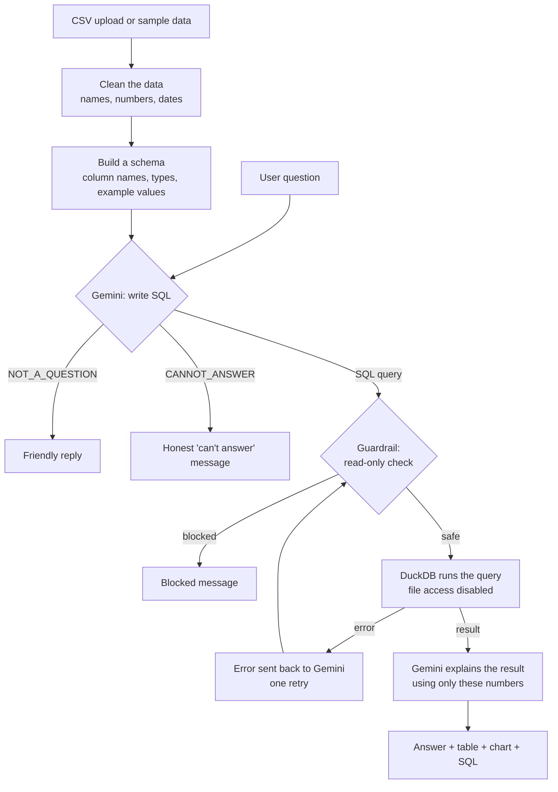

# 📊 Data Insights Chatbot

Ask questions about **any CSV file** in plain English and get back an answer, a table, a chart and the SQL behind it. Built with Python, Streamlit, DuckDB and Google Gemini.

**🔗 Live app:** https://amisha-data-chatbot.streamlit.app

**Example:** upload a car dataset and ask *"Which is the fastest car?"* → the app writes the SQL, runs it, shows the result and explains it: *"The Rimac C_Two is the fastest, with a 0–60 mph time of 1.8 seconds. Fastest = lowest 0–60 time."*


---

## How it works



1. **Clean the data on load.** Column names become `snake_case`, numbers stored as text (`"101,200"`) become real numbers, and date-like text becomes real dates.
2. **Text-to-SQL.** Gemini gets a description of the table (column names, types and example values) and writes a SQL query.
3. **The database does the maths.** DuckDB runs the query, so the numbers are exact and repeatable.
4. **Grounded explanation.** A second Gemini call explains the result, using only the numbers it was given, and states the measure it used.
5. **Charts by rules, not by the LLM.** Line chart for time series, bar chart for categories, none for single values.

## Tech stack

| Part | Tool | Why |
|---|---|---|
| LLM | Google Gemini (`gemini-3.5-flash-lite`) | Free tier, fast, good at SQL |
| Database | DuckDB | Runs SQL directly on a DataFrame, no server needed |
| Data | pandas | Loading, cleaning and ground-truth checks |
| Interface | Streamlit | A web UI in pure Python |
| Hosting | Streamlit Community Cloud | Free deployment from GitHub |

## Key design decisions

**Working with any CSV**
- **General cleaning rules, applied to every column**, rather than special cases: clean names (duplicates get `_2`), detect numbers stored as text (commas removed), and detect dates. A column is converted only if more than 90% of its values convert.
- **Cleaning never silently deletes information.** If converting a column to numbers would erase some values (like `"Electric"` in an engine-size column), the original text is kept in a `<column>_text` column, and the prompt explains what these columns mean.
- **Example values in the schema.** Columns with 10 or fewer distinct values are listed in full and labelled `all values`, so the model uses exact filters (`= 'Home & Kitchen'`). Other columns show 3 examples.

**Reliability**
- **Two LLM calls per question** (write SQL, then explain). Each prompt has one job, and the app checks the SQL before anything is explained.
- **Self-correction:** if the SQL fails, the error goes back to the model for one retry. Blocked queries are not retried.
- **Intent check:** greetings and small talk get a friendly reply instead of a data query, which also saves an LLM call.
- **Answers show their evidence:** the model is told to include the column it ranked or filtered by, and the explanation states the measure used.
- **Conversation memory:** the last 3 questions and their SQL are sent with each request, so follow-ups like *"what about the lowest?"* work. The chat resets when the dataset changes.
- **Graceful errors:** Gemini server errors, rate limits (429) and unexpected failures show a clear message instead of crashing the app.

**Safety (defense in depth)**
1. *Prompt rules:* only SELECT queries; reply `CANNOT_ANSWER` when the data doesn't support the question; never substitute a similar-sounding column.
2. *Code guardrail:* allows a single SELECT/WITH statement only, using whole-word keyword matching and blocking semicolons.
3. *Database lock:* DuckDB runs with external access disabled, so a query can't read files from disk. Each question gets its own connection, so users' data stays separate.
4. *User text is HTML-escaped* before it's shown on the page.

**Structure**
- `engine.py` holds all the logic and has no Streamlit code, so `eval.py` can test it directly. `app.py` only handles display.
- File loading is cached with `@st.cache_data`, so a file isn't re-read on every interaction.

## What is sent to Gemini

Being clear about what leaves the system:
- column names, types and **a few example values** per column (up to 10 for low-cardinality columns)
- the question, plus the last 3 questions and their SQL
- the **query result**, for the explanation step

The raw table is never sent in full. The app asks users not to upload private or sensitive data, because on Gemini's free tier, submitted content may be used by Google to improve its products.

## Evaluation

`eval.py` runs 12 test questions against the real pipeline and checks the answers against ground truth calculated independently in pandas.

| Test type | What it checks | Count |
|---|---|---|
| Value | The result contains the correct answer (numbers within 1%) | 8 |
| Refusal | Questions the data can't answer are refused | 2 |
| Greeting | Small talk gets the friendly reply, with no query | 2 |

**Current score: 12/12**, checked after every prompt change.

The evaluation caught a real regression: removing the sales-specific example from the refusal rule (to support uploaded data) made the model answer *"top 5 customers"* using `customer_segment`. Replacing the example with a general rule against substituting similar-sounding columns fixed it, confirmed over repeated runs.

I also tested the app on a real Kaggle dataset (sports car prices) and checked its answers against pandas.

## Problems I found and fixed

| Problem | Cause | Fix |
|---|---|---|
| The model invented column names | It had never seen the table | Send the schema in the prompt (grounding) |
| The guardrail blocked `created_at` | Substring match found "CREATE" inside it | Whole-word regex matching |
| `SELECT ...; DROP TABLE` would pass a first-word check | Hidden second statement | Block semicolons in the middle of a query |
| A query used `read_csv_auto()` to read a file from disk | Keyword filters can't list every risky function | Disable external access in DuckDB |
| Vague questions were refused | Refusal rule was too broad | Precise refusal rule + few-shot examples |
| "hi" returned a data summary | The vague-question rule caught small talk | Intent check (`NOT_A_QUESTION`) |
| Year questions needed a retry | Dates were loaded as text | Automatic date detection on load |
| *"Kitchen products"* used a fuzzy `ILIKE '%kitchen%'` | `e.g.` told the model the value list was incomplete | Send the full list for low-cardinality columns, labelled `all values` |
| *"Top customers"* answered with `customer_segment` | Removing a sales-specific example removed a guard | General rule: don't substitute similar-sounding columns |
| Car prices and times couldn't be sorted | Numbers stored as text (`"101,200"`, `"< 1.9"`) | Automatic number detection on load |
| *"List electric cars"* couldn't be answered | Number conversion erased `"Electric"` | Keep lost values in `_text` columns, and explain them in the prompt |
| Answers named a car but gave no numbers | The SQL selected only the name | Rule: include the column used for ranking; explanation states the measure |
| Years displayed as `2,021` | Thousands separators applied to every number | Plain format for year columns |

## Run it locally

```bash
pip install -r requirements.txt
export GEMINI_API_KEY="your-key"     # get a free key at aistudio.google.com
streamlit run app.py
```

Run the evaluation:

```bash
python eval.py
```

## Files

| File | Purpose |
|---|---|
| `engine.py` | Data cleaning, schema, prompts, guardrail, DuckDB and the question-to-answer pipeline |
| `app.py` | Streamlit interface: upload, chat, memory, charts and error handling |
| `eval.py` | Evaluation set with ground-truth answers |
| `sample_sales.csv` | 3,000 synthetic e-commerce orders (2024–2025) |
| `requirements.txt` | Python libraries |
| `.streamlit/config.toml` | Theme colours |

## Known limitations

- **One table at a time.** No JOINs across multiple files.
- **Ambiguous dates are read month-first:** `05/01/2024` is read as 1 May, not 5 January. `YYYY-MM-DD` is safest.
- **Mostly-numeric columns are converted to numbers;** values that aren't numbers (like `"< 1.9"` or `"1000+"`) become empty in that column, with the original text kept in a `_text` column.
- **Charts only handle two-column results.**
- **The evaluation checks result tables, not the written explanations,** and covers only the sample data.
- **A public app shares one free-tier API key,** so heavy use hits the per-minute and daily limits.

## Next steps

- Support multiple tables with JOINs.
- Add evaluation questions for uploaded datasets, and grade explanations with LLM-as-a-judge.
- Rate-limit questions per user.
- Let the model pick the chart type for unusual result shapes.
